# AVA Kung-Fu

[](https://github.com/Harlock123/AVAKungFu/actions/workflows/build.yml)

A side-scrolling martial-arts game in the style of Irem's 1984 arcade game **Kung-Fu Master**, built with
.NET 10 and Avalonia UI. Fight up five floors of a temple to free Mei. Each floor is a long corridor full
of attackers from both sides, with a keeper guarding the stairs at the far end.

## Features

- **Five moves and three heights**:
  - **Moving:** walk either way, jump, and crouch.
  - **Blows:** punch and kick standing, punch and kick low from a crouch, and a flying kick in the air.
  - **Heights:** every blow lands high, in the middle or low, and every thrown thing flies high or low. Duck the high ones, jump the low ones.
- **The crowd**, coming from both ends of the corridor:
  - **Clingers** walk up and grab hold, draining your energy until you wriggle free.
  - **Blade men** keep their distance and throw knives high or low. They take two hits.
  - **Imps** run in low, so only a low blow stops them on the ground. They leap for your head and hang on.
  - **Jars** fall from the rafters on the second and fourth floors and break into snakes that only a low kick stops.
- **The keepers of the stairs**, one per floor:
  - **Bo of the Staff:** a long reach.
  - **Kiri the Thrower:** he keeps back and throws a boomerang that comes home.
  - **Grommel the Giant:** slow, big and hard-hitting.
  - **Shade the Sorcerer:** he throws fire, vanishes when hit, and reappears between you and the stairs.
  - **The Jade Master:** the quickest of them all.
  - **Reading them:** each winds up before it strikes, and a light shows where the blow will land.
- **Energy and time**: an energy bar for you and one for the keeper, and a clock for every floor. Run out of either and you lose a life and start the floor again.
- **The floor bonus**: time and energy left are paid in points at the top of each floor. Free Mei at the top of the fifth for a big bonus, then go round again, harder.
- **Scoring**:
  - Clingers 100, imps 200, blade men 500, snakes 200, a jar broken in the air 100
  - The floor bonus, and the rescue bonus
  - An extra life at 30,000 points and every 50,000 after that
- **Sound**: a pentatonic theme in D over a drum-and-bass beat, with punches, kicks, hits, grabs, knives, breaking jars, hissing snakes, the sorcerer's vanishing and a keeper going down. All of it is synthesised and mixed by OpenAL.
- **Attract mode**: leave the title alone for 15 seconds and a computer fighter plays. It wriggles free, ducks and jumps the knives, low-kicks imps and snakes, and reads each keeper's wind-up to dodge it and hit back.
- **A top-ten high-score table** with arcade-style initials entry. It records the floor reached.
- **Gamepads** through SDL2, as well as the keyboard.
- **Any window size**: the screen scales to fit, letterboxed. **Ctrl+S** saves a screenshot.
- **One self-contained executable** per platform: Windows, macOS and Linux on Intel/AMD and ARM.

## Screenshots

| The title | Floor one | A kick |
|:---------:|:---------:|:------:|
| 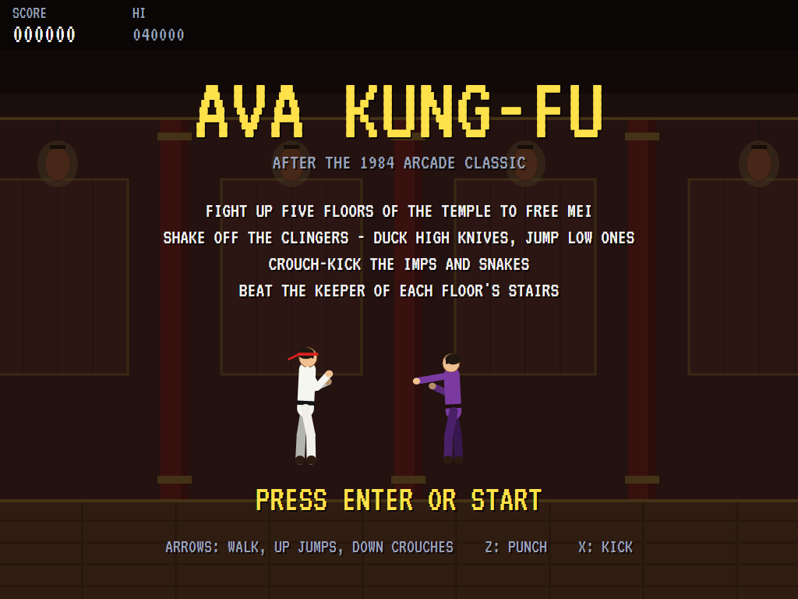 | 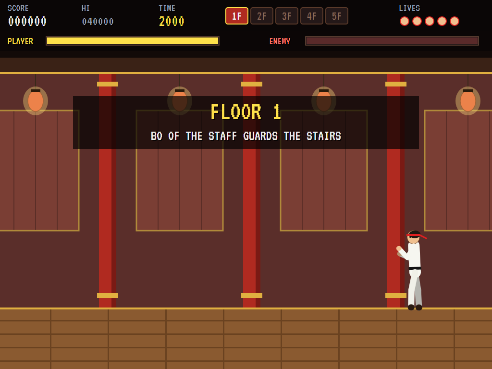 | 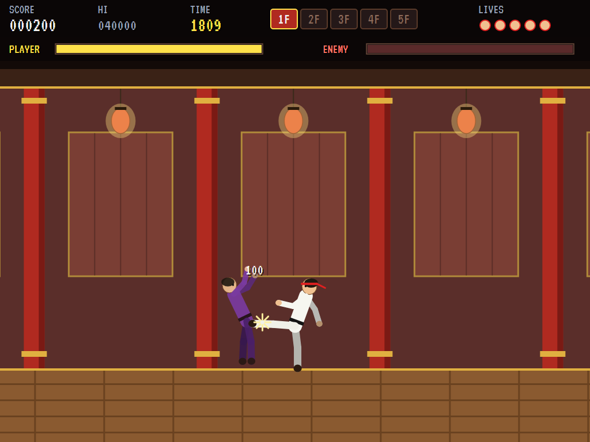 |
| How to fight. | The temple's first corridor. | A clinger goes down. |

| Held | A knife | Bo of the Staff |
|:----:|:-------:|:---------------:|
| 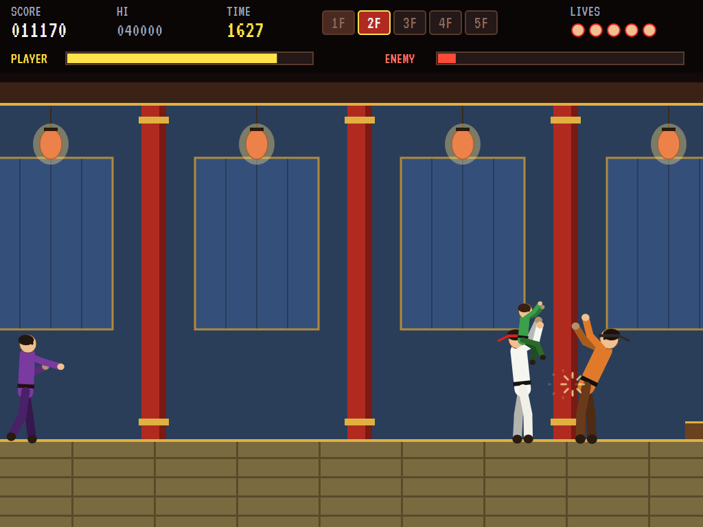 | 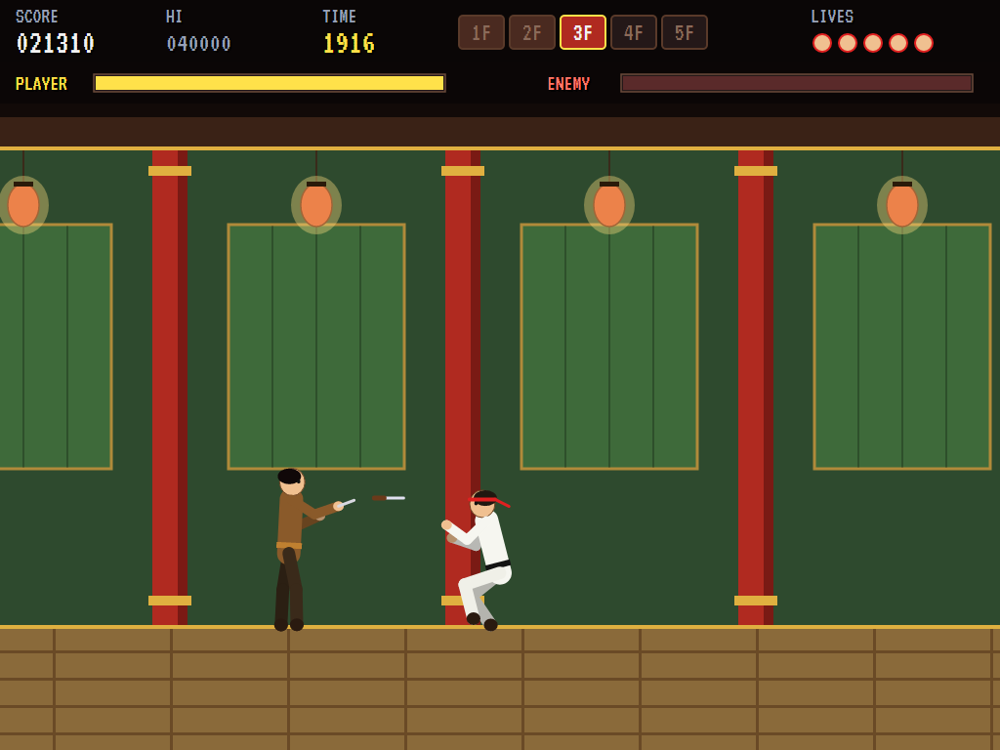 | 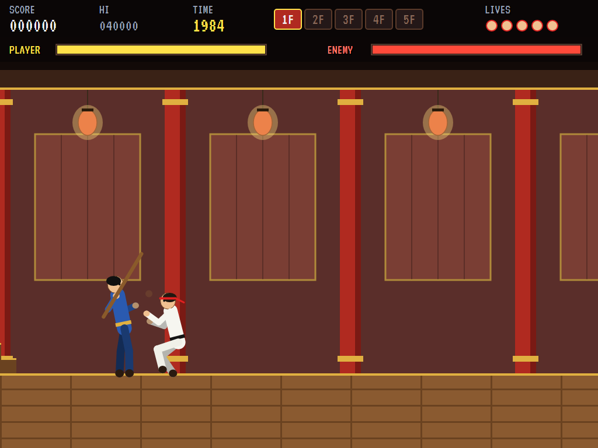 |
| An imp on your head. | Duck the high ones. | The first keeper winds up. |

| Jars and snakes | Grommel the Giant | Shade the Sorcerer |
|:---------------:|:-----------------:|:------------------:|
| 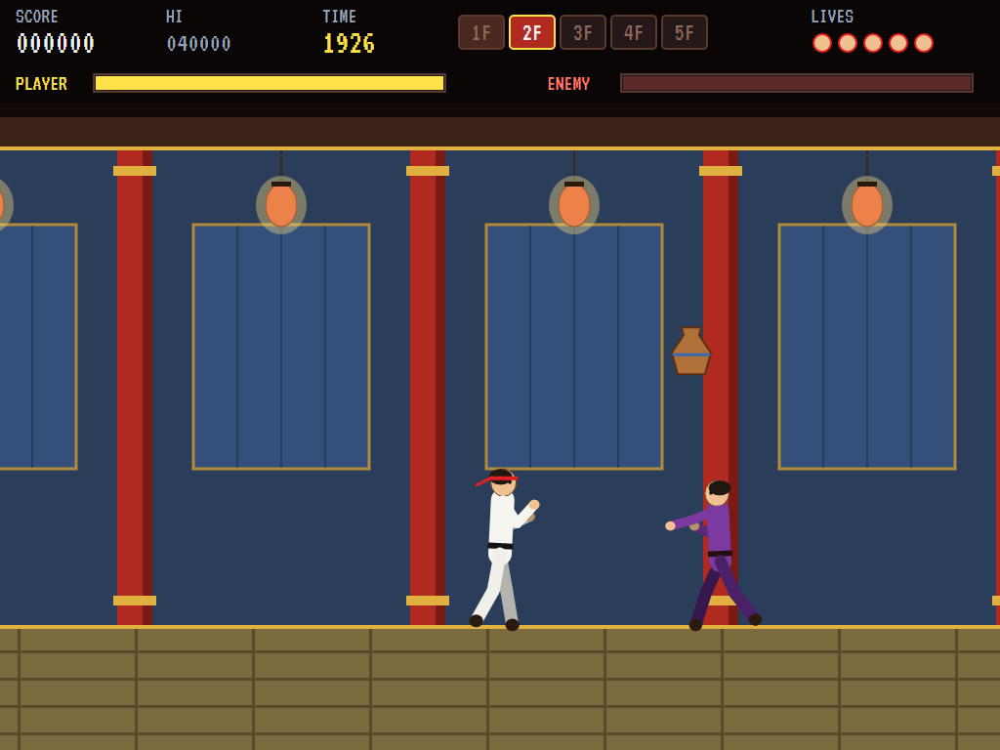 | 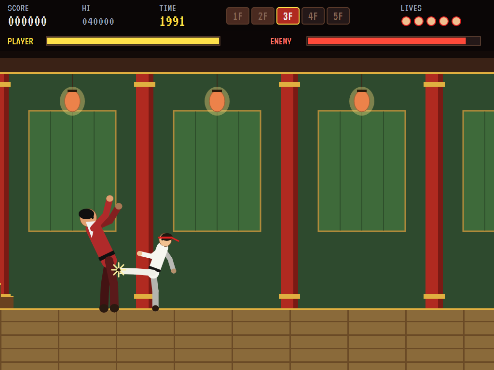 | 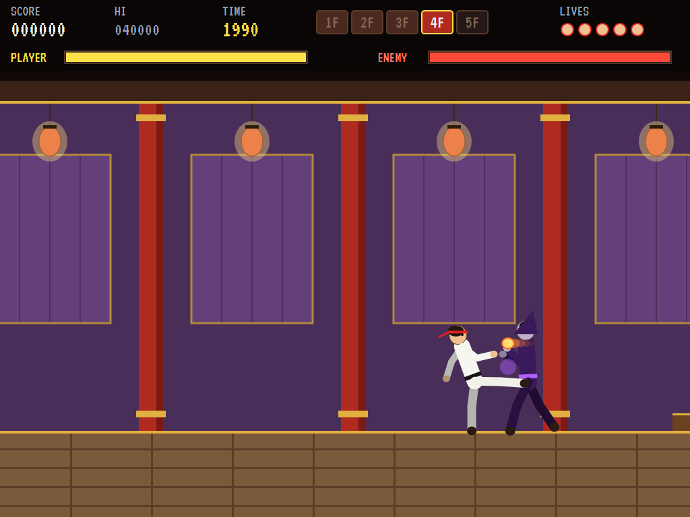 |
| From the rafters. | Slow and heavy. | Fire, then gone. |

| The Jade Master | Mei is free | Down |
|:---------------:|:-----------:|:----:|
| 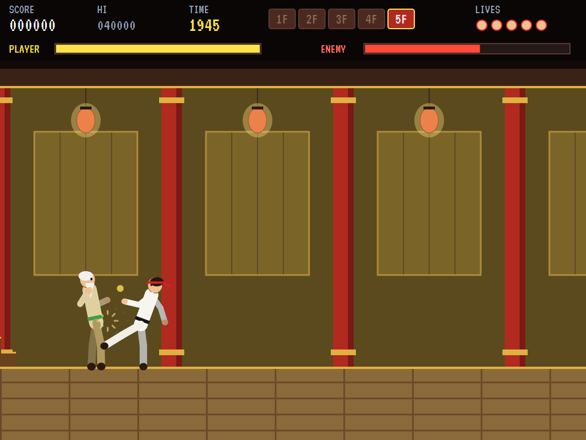 | 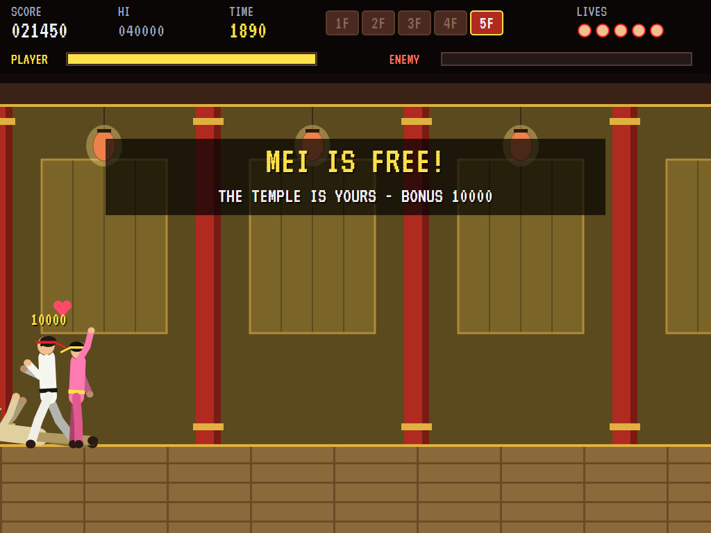 | 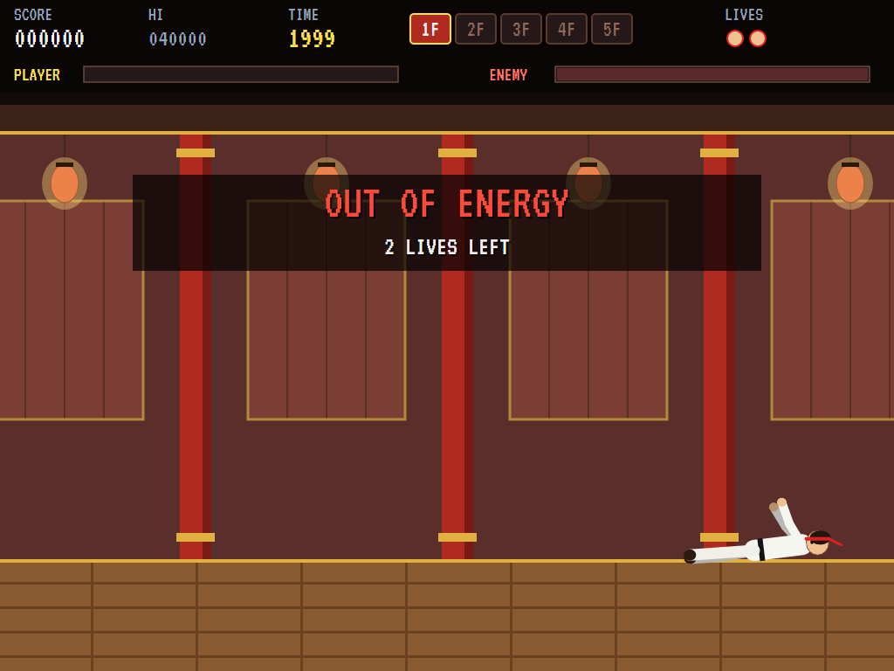 |
| The last of them. | At the top of the temple. | Out of energy. |

| The best fighters | | |
|:-----------------:|:-:|:-:|
| 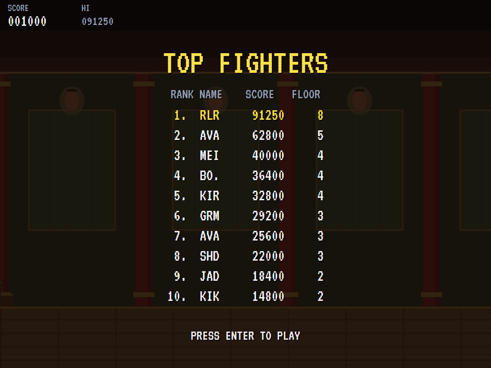 | | |
| The high-score table. | | |

The screenshots are made by the tests, which play the game in a real (headless) window; see
[Tests](#tests).

## Download and run

Ready-to-run builds for Windows, macOS and Linux, on both Intel/AMD and ARM, are on the
[Releases page](https://github.com/Harlock123/AVAKungFu/releases/tag/latest). **Latest build** is
rebuilt on every push to `main`. Each download is one self-contained executable: no .NET install is
needed.

| Platform | Archive |
|---|---|
| Windows | `AVAKungFu-win-x64.zip`, `AVAKungFu-win-x86.zip`, `AVAKungFu-win-arm64.zip` |
| macOS | `AVAKungFu-osx-arm64.tar.gz` (Apple silicon), `AVAKungFu-osx-x64.tar.gz` (Intel) |
| Linux | `AVAKungFu-linux-x64.tar.gz`, `AVAKungFu-linux-arm64.tar.gz`, `AVAKungFu-linux-arm.tar.gz` |

```bash
tar -xzf AVAKungFu-linux-x64.tar.gz     # or linux-arm64, linux-arm, osx-arm64, osx-x64
./AVAKungFu
```

On Windows, unzip and run `AVAKungFu.exe`. On macOS, if Gatekeeper refuses to open it, run
`xattr -d com.apple.quarantine AVAKungFu` once. Run with `--no-audio` for silence.

**Sound** comes through OpenAL Soft, built in for every platform. In a virtual machine the game
detects it and uses a larger audio buffer, so the sound doesn't break up.

**Gamepads** use SDL2, which is bundled for Windows, macOS and Intel/AMD Linux. ARM Linux builds need it
installed; without it the keyboard still works:

```bash
sudo apt install libsdl2-dev            # Debian / Ubuntu / Raspberry Pi OS
sudo pacman -S --needed sdl2-compat     # Arch / Omarchy
```

## Controls

| Input | Action |
|-------|--------|
| **Enter** | Start |
| **Left** / **Right** (or **A** / **D**) | Walk, and turn |
| **Up** / **W** | Jump |
| **Down** / **S** (hold) | Crouch |
| **Z** / **J** / **Ctrl** | Punch (low, if crouching) |
| **X** / **K** / **Space** / **Alt** | Kick (low if crouching, flying if in the air) |
| **Left**, **Right**, **Left**… | Wriggle free when held |
| **P** / **Esc** | Pause (Esc again to quit) |
| **M** | Mute |
| **Ctrl+S** / **Cmd+S** | Save a screenshot to the Pictures folder |

**Gamepad**: left stick or D-pad to walk, jump and crouch, **X** or **Y** to punch, **A** or **B** to
kick, **Start** to start and pause, **Back** (while paused) to quit.

**Entering initials**: type letters, or dial with **Up**/**Down** and accept with **Space**; **Left** /
**Backspace** go back; **Enter** finishes.

## Tests

```bash
dotnet test AVAKungFu.slnx
```

The engine has no UI and runs in fixed 60 Hz steps, so it plays the same at any frame rate, and a seed
always plays the same game. The tests check, mostly with attackers placed where the test wants them:

- **Moving:** each floor's direction, walking, jumping, crouching and turning
- **The crowd:**
  - kicks and punches in and out of reach
  - a clinger's hold draining energy until shaken off
  - a blade man's two hits, and knives ducked and jumped
  - imps only falling to a low blow on the ground, and hanging on when they land on your head
  - a jar breaking into a snake that only a low kick stops
- **The keepers:**
  - the keeper barring the way until beaten, then the climb to the stairs and the next floor
  - every blow dodged by its height
  - the thrower's returning boomerang, and the sorcerer vanishing and untouchable unseen
- **Time, lives, laps:**
  - losing a life to the clock or to energy, and the last ending the game
  - the five keepers, the rescue, and the harder second lap
  - the floor bonus
- **The machine:** the computer fighter climbing the first floor, the attract cycle, the same game from the same seed, initials and the high-score file

The screenshot tests draw the real screen in a headless window. To refresh the README's pictures:

```bash
KUNGFU_SHOTS=$PWD/Images dotnet test tests/AVAKungFu.Tests --filter ScreenshotTests
```

To see how the computer fighter gets on, floor by floor (for tuning):

```bash
KUNGFU_PROBE=1 dotnet test tests/AVAKungFu.Tests --filter PilotProbe --logger "console;verbosity=detailed"
```

## Building

```bash
dotnet build AVAKungFu.slnx
dotnet run --project src/AVAKungFu
```

Needs the .NET 10 SDK. The sounds are made by `tools/make_sounds.py` (standard-library Python):
`python3 tools/make_sounds.py` rewrites `src/AVAKungFu/Sounds`.

## Project structure

```
AVAKungFu/
├── AVAKungFu.slnx
├── src/AVAKungFu/
│   ├── Engine/
│   │   ├── GameEngine.cs        # States, the title and demo cycle, and the music
│   │   ├── GameEngine.Play.cs   # The hero's moves and blows, the crowd, knives and jars, the five keepers,
│   │   │                        # energy, the clock, floors, the rescue and laps
│   │   ├── MasterPilot.cs       # The computer fighter, for the demonstration (and the tests)
│   │   ├── Entities.cs
│   │   ├── HighScoreTable.cs, InitialsEntry.cs
│   │   ├── InputHandler.cs, ControllerManager.cs  # Keys and an SDL2 gamepad
│   │   └── SoundManager.cs      # Effects, the theme and the tunes through OpenAL
│   ├── Audio/                   # The OpenAL engine (from the author's AVABand)
│   ├── Views/                   # The temple, jointed fighters posed move by move, and the screens
│   └── Sounds/                  # The synthesised effects and tunes
├── tests/AVAKungFu.Tests/       # Gameplay, screenshot and probe tests
├── tools/make_sounds.py
└── Images/                      # Screenshots
```

## About and licence

AVA Kung-Fu © 2026 Lonnie Watson, under the [MIT License](LICENSE).

*Kung-Fu Master* © 1984 Irem; the name belongs to its current owner. AVA Kung-Fu is an independent,
unofficial game in its style. Its hero, Mei, the keepers and their names, the temple, graphics, sounds,
tunes and code are its own; nothing is taken from the arcade machine's program, graphics, sound or
music. It is not affiliated with or endorsed by any rights holder.
